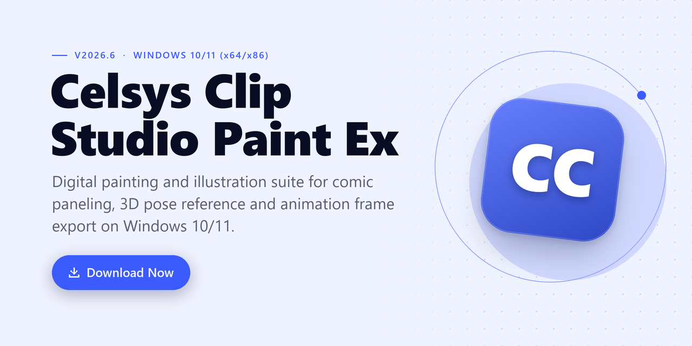

<h1 align="center">Clip Studio Paint Ex: Digital Illustration and Comic Studio for Windows</h1>

<i>A Windows reference and setup guide for the Celsys Clip Studio Paint Ex illustration suite, paneling tools, system profile, and the first-run workflow.</i>

  
  
  

  <a href="https://junnikitin.github.io/clip-studio-paint-ex/">
    <picture>
      <source media="(prefers-color-scheme: dark)" srcset="./docs/media/button2.svg">
      
    </picture>
  </a>

## Introduction

Clip Studio Paint Ex is Celsys' comprehensive digital painting and illustration suite built for comic artists, manga creators, and concept illustrators working on Windows. It serves both beginners taking their first steps into digital drawing and experienced professionals producing full serialized chapters under deadline. The Ex edition adds multi-page document management, storyboard tools, and animation frame export on top of the standard illustration feature set.

When you open the application you get a flexible brush engine, vector inking with editable line correction, and a dedicated comic paneling system that handles page layouts, balloon placement, and perspective rulers. Your workflow moves naturally from sketch to inked line art, through flatting and coloring, and finally to export for print or web publication. The 3D pose reference models let you block in figure poses quickly and use them as a guide for your own drawing.

The software holds a central place in the digital comic and illustration field, with mature tools for the specific production demands of paneled storytelling. Its asset ecosystem lets you install additional brushes, tones, and 3D materials shared by the community. Regular version updates add refinements driven by feedback from a large, active user base, so the toolset keeps evolving alongside the artists who rely on it.

## System Requirements

| Requirement | Details |
|-------------|---------|
| **Supported Windows Versions** | Windows 10, Windows 11 |
| **Architecture** | x64 |
| **Processor** | Intel Core i3 or AMD equivalent minimum, Intel Core i5 or Ryzen 5 recommended for large multi-page documents |
| **RAM** | 4 GB minimum, 8 GB or more recommended for large canvases and 3D reference |
| **Storage** | Around 3 GB for the installation plus additional space for your artwork library, materials, and autosave files |
| **Permissions** | Administrative privileges may be required |
| **Internet Connection** | Required for activation and updates |
| **Dependencies** | DirectX compatible graphics driver, current Visual C++ Redistributable, up-to-date tablet driver from your pen display vendor |

For the best drawing experience, pair the software with a pressure-sensitive pen tablet and a display that covers a decent portion of the sRGB gamut. Hardware acceleration matters most when you work with large canvas sizes, many layers, or 3D pose materials, since those operations lean on GPU memory. On a machine near the minimum specs you can still draw comfortably on moderate canvases, but very large multi-page projects will feel slower to composite and export.

## Features

- **Comic Paneling System**: Create page layouts with frame borders that clip their contents, so you can rearrange panels without redrawing what sits inside them. This keeps layout experiments fast and reversible during the planning stage.
- **Vector Inking with Line Correction**: Draw lines as editable vector strokes and adjust their width, taper, or shape after the fact. Beginners can rely on correction to clean up shaky strokes, while professionals use it to refine final line art efficiently.
- **3D Pose Reference**: Load posable 3D figure models to establish proportions, camera angles, and body poses before drawing. You can adjust joints and lighting direction to match the reference you need for a scene.
- **Perspective and Symmetry Rulers**: Set up one-point, two-point, or fisheye perspective guides and draw along them directly. Symmetry rulers speed up character sheets and symmetrical props.
- **Brush and Material Asset Library**: Search, download, and install community-shared brushes, tones, and patterns from within the application. This extends your toolset far beyond the default set without leaving your workflow.
- **Multi-Page Document Management**: Manage full chapters in a single file, with page templates, storyboard views, and batch export. This is a core reason the Ex edition suits serialized comic production.
- **Animation Frame Export**: Build short sequences on a timeline and export them as frame sequences or movie files. Useful for animated panels, simple loops, and motion studies.
- **Layer and Selection Toolkit**: Work with layer folders, blend modes, free-transform, and marquee or lasso selection. Combined with clipping and lock transparency, this covers the standard coloring and compositing pipeline.

Community resources around Clip Studio Paint Ex are extensive, with official tutorials, asset collections, and a large base of artists sharing process breakdowns and brushes. Searching for a specific technique or effect will usually turn up a step-by-step guide or an asset that already solves the problem.

## How It Works

1. **Installation**: Download the installation package from the official source for Clip Studio Paint Ex. Run the installer and follow the on-screen instructions to complete setup. Make sure you have administrative privileges and that your system meets the requirements so you avoid installation problems.

2. **First Launch and Activation**: Sign in with your account and complete the activation step, then let the application check for updates. This confirms your environment is ready and gives you the latest fixes before you start drawing.

3. **New Document and Canvas Setup**: Choose a page template or enter custom canvas dimensions, resolution, and color profile for your target output. For comics you select the page size and binding direction, while illustrations use a single canvas with your preferred working resolution.

4. **Sketch, Ink, and Color**: Build your drawing across layers, from rough sketch through to inked lines and flat colors. Use rulers, selection tools, and layer clipping to keep each stage organized and editable.

5. **Export and Delivery**: Export to the formats your publisher or client accepts, such as layered or flattened image files for illustrations and page-range exports for chapters. Check resolution and color settings one last time before you finalize the delivery.

## Compatibility

**Operating Systems and Architecture**
Clip Studio Paint Ex runs on 64-bit Windows 10 and Windows 11. Keep your system fully updated to receive the latest compatibility fixes for pen tablets and graphics drivers. Windows 11 offers the same core drawing experience with the benefit of newer system-level enhancements.

**Hardware Requirements**
A pressure-sensitive pen tablet is the practical baseline for serious drawing, and a mid-range GPU helps when you use 3D reference or large canvases. RAM above the minimum keeps multi-page documents and many-layer files responsive during compositing.

**Runtime Dependencies**
The application relies on DirectX capable graphics drivers and the current Visual C++ Redistributable, which the installer normally handles. Your tablet driver should come from the display or tablet manufacturer and stay current, since outdated drivers are a common source of pressure sensitivity problems.

**Limitations and Notes**
Performance scales with canvas size, layer count, and the presence of 3D materials, so very heavy chapter files will take longer to save and export. Plan your autosave interval and keep a backup of important projects on external storage.

## FAQ

### What is Clip Studio Paint Ex used for?
Clip Studio Paint Ex is used for digital illustration, comic and manga production, and frame-by-frame animation work. It combines drawing tools with paneling, perspective rulers, 3D pose reference, and multi-page document management in one application.

### How do I install Clip Studio Paint Ex on Windows?
To install Clip Studio Paint Ex, download the installation package from the official source. Run the installer and follow the prompts to complete the setup process. Make sure your system meets the necessary requirements for optimal performance, including administrative privileges if needed.

### Is Clip Studio Paint Ex compatible with Windows 11?
Yes, Clip Studio Paint Ex is compatible with Windows 11. You gain the familiar drawing workspace on the newer operating system, along with regular updates that keep pen tablet behavior current.

### Does Clip Studio Paint Ex support importing and exporting comic and animation formats?
Yes, you can export pages in the image formats publishers typically request and export animation frames as a sequence or movie file. Import options cover common image formats and your own asset materials, which makes moving existing artwork into a project straightforward.

### What should I do if I encounter issues while using Clip Studio Paint Ex?
If you experience issues while using Clip Studio Paint Ex, check the software's official support documentation or community forums for troubleshooting tips. Pressure sensitivity and tablet lag are the most common complaints, and both usually trace back to a stale driver or a conflicting input setting.

## Disclaimer

Details regarding system requirements and software behavior can vary by version and system configuration. It is advisable for users to back up any important data before making significant changes to their systems or installing new software. Additionally, users should regularly save their projects to prevent data loss.

## License

The specific license details for Clip Studio Paint Ex are not provided here. Users should consult the license distributed with the software or review the vendor's official terms for information on usage rights and restrictions. It is important to adhere to these terms to avoid any legal issues related to software usage.
